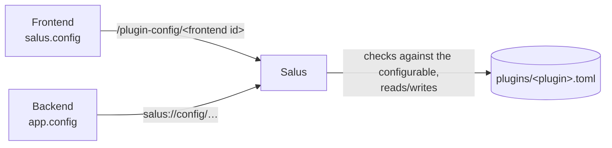

# Settings

Salus keeps the settings of the framework and of every plugin, so they survive updates, reinstalls and restarts. Each plugin
has **one config file** with its values, and a **configurable** that says which settings exist. Users change the values in the
settings plugin; your plugin reads them (and may change them) through the SDK.

| | What it is | Who changes it |
|---|---|---|
| **Configurable** | The list of settings: key, type, default, display name and explanation. Part of your plugin, named in the manifest. | You, when you write the plugin. Salus never changes it. |
| **Config file** | The values. One file per plugin, in Salus' config directory. | Salus, on behalf of the user (settings plugin) or of your plugin (SDK). |

## The configurable

A TOML file inside your plugin folder. Name it in the manifest:

```toml
[config]
configurable = "configurable.toml"      # relative to the plugin folder
```

```toml
[[setting]]
key = "zoom_step"                       # name of the setting: letters, digits, _ and -
name = "Zoom step"                      # shown to the user
description = "How far one click on a zoom button zooms."
type = "float"
default = 1.5
min = 1.1
max = 4

[[setting]]
key = "renderer"
name = "Renderer"
description = "Which renderer draws the slide."
type = "choice"
choices = ["fast", "exact"]
default = "fast"

[[setting]]
key = "export_dir"
name = "Export folder"
type = "directory-path"                 # no default: unset until the user chooses
```

| Key | Meaning |
|---|---|
| `key` | Required. Unique in the file; letters, digits, `_` and `-`. |
| `name` | Required. The display name. |
| `description` | Optional. An explanation shown next to the setting. |
| `type` | Required, see below. |
| `default` | Optional. Must fit the type. Without one the setting is *unset* until someone sets it, and reads as `None`/`undefined`. |
| `min`, `max` | Optional, `int` and `float` only. Inclusive limits. |
| `choices` | Required for `choice`, not allowed otherwise. A list of strings. |

| `type` | Value | Notes |
|---|---|---|
| `int` | integer | `1.5` is refused. |
| `float` | number | An integer is accepted and stored as a float. |
| `bool` | `true` / `false` | |
| `string` | text | |
| `choice` | one of `choices` | |
| `file-path` | text | A path to a file. Salus does not check that it exists. |
| `directory-path` | text | A path to a folder. Salus does not check that it exists. |

A configurable that cannot be read (unknown type, a default that does not fit, a duplicate key, ...) stops the plugin from loading; the
server log says why. Salus has a configurable of its own, built into the server.

## Using the settings

=== "Python backend"

    ```python
    app = salus.Plugin()

    step = await app.config.get("zoom_step")          # 1.5 unless the user changed it
    everything = await app.config.all()               # {"zoom_step": 1.5, "renderer": "fast"}
    await app.config.set("renderer", "exact")         # SalusError if it does not fit the configurable
    await app.config.update({"zoom_step": 2, "renderer": "fast"})   # several at once, all or none
    await app.config.reset("zoom_step")               # back to the default
    ```

=== "JavaScript frontend"

    ```js
    const step = await salus.config.get("zoom_step");   // 1.5 unless the user changed it
    const everything = await salus.config.all();
    await salus.config.set("renderer", "exact");        // rejects with HttpError 400 if it does not fit
    await salus.config.update({ zoom_step: 2, renderer: "fast" });
    await salus.config.reset("zoom_step");
    ```

- **Values are checked** against the configurable on every change. A refused change changes nothing; the error says why.
- **Reads are live.** `get` asks Salus each time, so you see changes the user made in the settings. Read again when you need the current value
  (for example when a panel gets focus); there is no change notification yet.
- **The settings belong to the plugin, not to a user.** Everyone who uses the plugin shares them. Keep per-user data in your own storage.
- **Settings are for settings,** not for data. The whole config file is read on every call.
- **Unknown keys are refused,** so a typo in `set` is an error rather than a setting nobody sees.

## Where the files are

```text
<config root>/
├── salus.toml                      the settings of Salus
└── plugins/
    └── <plugin folder name>.toml   the settings of one plugin
```

`<config root>` is the per-user config location of the operating system, for example `~/.config/salus` on Linux.
On macOS the config and data locations are the same folder (`~/Library/Application Support/org.fredericmrozinski.salus`),
which also holds the installed plugins in `plugins/`. There the config root is its `config` subfolder, so the two never mix:

```text
~/Library/Application Support/org.fredericmrozinski.salus/
├── plugins/                        installed plugins
└── config/                         <config root>
    ├── salus.toml
    └── plugins/<plugin folder name>.toml
```

`<plugin folder name>` is the name of your plugin's folder in the plugins directory. Users may edit the files by hand; Salus
ignores values that no longer fit the configurable. A file that is not valid TOML is reported in the server log, read as empty, and
**not overwritten** (changes are refused until it is fixed). Salus rewrites the file when a setting changes, so comments in it are not kept.

## The settings of Salus

| Setting | Default | Meaning |
|---|---|---|
| `theme` | `dark` | The colors of Salus and all plugins: `dark`, `light`, `light-red`, `dark-green`, `dark-oled` or `midnight`. Applies at once. See [Theming](theming.md). |
| `plugins_dir` | empty | Where plugins are installed. Empty means `plugins/` in the platform's data directory. A relative path is taken relative to the config root. Applies after a restart. |

## How the two sides get there

Salus owns the config file, so neither side opens it. The **backend** sends a request over its socket (`salus://config/get`, `salus://config/set`);
the **frontend** calls `/plugin-config/<frontend id>`. Salus checks that the caller belongs to the logged in user, finds the plugin of *that*
backend or frontend, checks the values against its configurable and reads or writes its file. Nobody can reach another plugin's settings this way.



## API summary

| Python (`app.config`, all `await`) | JavaScript (`salus.config`) |
|---|---|
| `all()` → dict | `all()` → object |
| `get(key, default=None)` | `get(key, fallback)` |
| `set(key, value)` | `set(key, value)` |
| `update(values)` → dict | `update(values)` → object |
| `reset(key)` | `reset(key)` |
| `all_blocking()`, `get_blocking(key, default=None)` | – |

`all_blocking` and `get_blocking` are for plain `def` handlers, which run in worker threads (like `send_blocking`); they raise if called from the event loop.

In `update`, a value of `None`/`null` resets that setting to its default.
