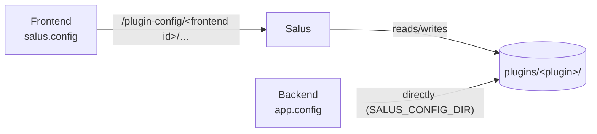

# Configuration files

Salus keeps its own settings and the settings of every plugin in the platform's config directory, so they survive
updates, reinstalls and restarts of a plugin.

```text
<config root>/
├── salus.toml                      the framework's settings
└── plugins/
    └── <plugin folder name>/       your plugin's config directory
```

`<config root>` is the per-user config location of the operating system, for example `~/.config/salus` on Linux.
On macOS the config and data locations are the same folder (`~/Library/Application Support/org.fredericmrozinski.salus`),
which also holds the installed plugins in `plugins/`. There the config root is its `config` subfolder, so the two never mix:

```text
~/Library/Application Support/org.fredericmrozinski.salus/
├── plugins/                        installed plugins
└── config/                         <config root>
    ├── salus.toml
    └── plugins/<plugin folder name>/
```

`<plugin folder name>` is the name of your plugin's folder in the plugins directory.

The plugins directory defaults to `plugins/` in the platform's data directory. To install plugins elsewhere, set
`plugins_dir` in `salus.toml` (a relative path is taken relative to the config root). The config location does not move.

Your plugin gets **one directory of its own**. Both parts of the plugin can read and write it, and they see the same files:

=== "Python backend"

    ```python
    app = salus.Plugin()

    settings = app.config.read_json("settings.json", default={"theme": "dark"})
    app.config.write_json("settings.json", {**settings, "last_dataset": "lung"})

    app.config.write_text("notes/today.txt", "hello")   # folders are created for you
    app.config.list()                                   # ["notes/", "settings.json"]
    app.config.path                                     # pathlib.Path of the directory
    ```

=== "JavaScript frontend"

    ```js
    const settings = await salus.config.readJson("settings.json", { theme: "dark" });
    await salus.config.writeJson("settings.json", { ...settings, lastDataset: "lung" });

    await salus.config.writeText("notes/today.txt", "hello");
    await salus.config.list();                          // ["notes/", "settings.json"]
    ```

## Rules

- **Names are relative paths** written with `/`, like `cache/index.json`. Names that would leave the directory (`..`,
  absolute paths, `\` or `:` in a name) are refused, and so are symbolic links that point out of it.
- **Writes replace the whole file at once.** A reader never sees half a file. Parent folders are created.
- **Missing files** are not errors when reading: `read_json`/`readJson` give you your default (`None`/`null` if you
  do not set one), `readText` gives `null`. Python's `read_text` and `read_bytes` raise `FileNotFoundError` unless you pass a
  `default`.
- **The directory belongs to the plugin, not to a user.** Everyone who uses the plugin shares it. Keep per-user data in
  a file per user, or in your own storage.
- **It is for settings and small state**, not for bulk data. The frontend can write files up to `plugin_config_max_file_bytes`
  (8 MiB by default); the backend writes the files itself and has no such limit.
- **Concurrent writers.** The frontend and the backend (and several frontends) may write the same file. The last
  write wins; there is no locking. Give each piece of state one owner, or put changes through the backend.

## How the two sides get there

The **backend** works on the directory directly. Salus creates it and starts your backend with its path in the environment
variable `SALUS_CONFIG_DIR`. `app.config` reads it for you. If you want to hand the folder to a library, use `app.config.path`.

The **frontend** cannot touch files, so `salus.config` asks Salus, which checks that the frontend belongs to the logged in
user and then reads or writes the files of *that frontend's plugin*. A frontend can never reach another plugin's directory.



## The framework's own settings

`salus.toml` is created with every setting commented out the first time the server starts. A file that cannot be read
is reported in the server log and replaced by the defaults, so a typo does not stop the server.

| Setting | Default | Meaning |
|---|---|---|
| `plugin_config_max_file_bytes` | `8388608` | Largest file a plugin frontend may write into its config directory. |

## API summary

| Python (`app.config`) | JavaScript (`salus.config`) |
|---|---|
| `read_text(name, default=None)` | `await readText(name)` → string or `null` |
| `read_bytes(name, default=None)` | `await readBytes(name)` → `Uint8Array` or `null` |
| `read_json(name, default=None)` | `await readJson(name, fallback = null)` |
| `write_text(name, text)` | `await writeText(name, text)` |
| `write_bytes(name, data)` | `await writeBytes(name, data)` |
| `write_json(name, value)` | `await writeJson(name, value)` |
| `exists(name)` | `await exists(name)` |
| `list(directory="")` | `await list(directory = "")` |
| `delete(name)` | `await delete(name)` |
| `path`, `path_of(name)` | – |

`list` returns sorted names; folders end with `/`. `delete` removes a file or a folder with everything in it and fails if it
does not exist (`FileNotFoundError` / `HttpError` 404).
